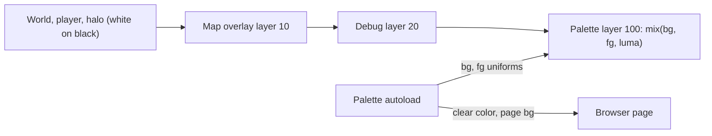

# Soft duotone palettes (Paper and Ink + Amber)

Status: planned, not built.

Replace pure black/white with two softer duotone palettes so the game is easier on the eyes in the dark. A single full-screen palette pass recolors the existing 1-bit rendering, P switches between palettes in-game, and the choice persists across reloads.

## Palettes
- **Paper and Ink** (default): background `#1E1C1A`, foreground `#DCD3C1`
- **Amber Terminal**: background `#1B1612`, foreground `#D9B27C`

Both are about 10-12:1 contrast, down from 21:1 for pure black on white.

## Approach: recolor the 1-bit image in one final pass
The game keeps drawing in pure black and white. One full-screen shader on the topmost layer maps each pixel's brightness onto the active palette: `mix(bg, fg, luma)`.

- No color changes are needed in [room.gd](../../src/world/room.gd), [player.tscn](../../src/player/player.tscn), [exit_halo.gd](../../src/world/exit_halo.gd), [map_overlay.gd](../../src/ui/map_overlay.gd), or [debug_overlay.gd](../../src/ui/debug_overlay.gd). The ~20 hardcoded `Color.WHITE`/`Color.BLACK` uses keep working.
- In-between tones follow the palette automatically: the dithered exit halo, the map dim (black at 72% alpha), and the gray current-room fill on the map.
- Future effects (Imprint sparkle, shatter, blackout) pick up the palette for free.
- Cost is one 320x180 quad per frame, negligible against the 60 fps budget.

## Changes
- **New `src/autoload/palette.gd`** (autoload `Palette`, `process_mode = ALWAYS` so P also works while the map is open):
  - `PALETTES` array of `{name, bg, fg}`, current `index`, and a `changed` signal.
  - Loads and saves `index` in `user://settings.cfg` with `ConfigFile`. On the web build this persists in the browser's IndexedDB.
  - On `palette` action just pressed: cycle, save, `apply()`.
  - `apply()` sets the shader uniforms, calls `RenderingServer.set_default_clear_color(bg)`, and on web runs `JavaScriptBridge.eval("document.body.style.backgroundColor='#...'")` so the browser letterbox matches.
  - Owns a CanvasLayer (layer 100) with a full-rect `ColorRect` (mouse ignore) using the shader below.
- **New `src/core/duotone.gdshader`**: `canvas_item` shader with `uniform sampler2D screen_tex : hint_screen_texture, filter_nearest;`, `uniform vec4 bg;`, `uniform vec4 fg;`. Computes luma from `texture(screen_tex, SCREEN_UV).rgb` and outputs `mix(bg, fg, luma)`.
- **[project.godot](../../project.godot)**:
  - Register the `Palette` autoload.
  - Add a `palette` input action on P (physical keycode 80).
  - Set `rendering/environment/defaults/default_clear_color` to the Ink background.
- **[tools/build_web.sh](../../tools/build_web.sh)**: also inject `` so the page doesn't flash pure black while the wasm loads.
- **[export_presets.cfg](../../export_presets.cfg)**: set `progressive_web_app/background_color` to the Ink background (cosmetic).

## Risks to check in the browser
- `hint_screen_texture` in the Compatibility renderer on web. If sampling fails, render the game into a SubViewport and run the duotone shader on its texture instead.
- Letterbox bars inside the canvas may stay pure black regardless of clear color. If so, size the palette `ColorRect` past the viewport, or rely on the page background with canvas resize policy Adaptive.

## Verification
- Rebuild with `tools/build_web.sh` and reload http://localhost:8060.
- Sample canvas pixels to confirm walls/floor equal `#DCD3C1` and empty space equals `#1E1C1A`.
- Press P and confirm amber values. Reload and confirm amber persists. Press P again to return to Ink.
- Hold Tab: map, dim, and current-room fill render in palette tones. F3 text stays legible. FPS stays at 60.
- Run `tests/physics_test.gd` headless to confirm movement is unchanged.

## Tasks
- [ ] Add `Palette` autoload (palettes, P cycling, `user://settings.cfg` persistence, clear color and web page background)
- [ ] Add `duotone.gdshader` and the top-layer full-rect `ColorRect` owned by `Palette`
- [ ] Register autoload, add P `palette` input action, set default clear color; update `build_web.sh` page background and PWA background
- [ ] Rebuild web and verify both palettes, P toggle, persistence after reload, map/F3 legibility, 60 FPS; run physics test
